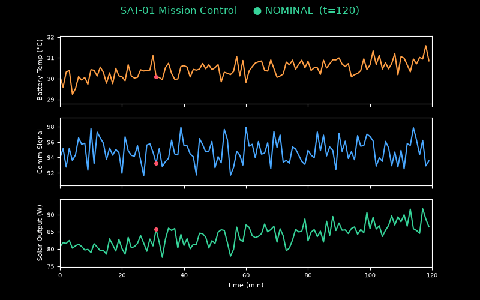
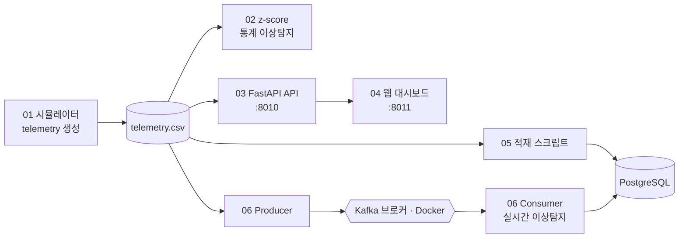

# 🛰️ Satellite Telemetry Monitoring Platform

가상의 위성에서 쏟아지는 **Telemetry(상태 원격측정) 데이터**를 실시간으로 받아 보여주는
**Mission Control(관제) 스타일 모니터링 시스템**을 만듭니다.

> 이 프로젝트는 "데이터 분석"보다 **백엔드 + 데이터 엔지니어링 + 우주 시스템** 역량을 보여줍니다.
> 명령어는 복사해서 **PowerShell**에 붙여넣으면 됩니다.



> telemetry가 실시간으로 흐르며, z-score로 탐지된 이상 지점이 **빨간 점**으로 나타납니다.
> (생성: `python src\make_demo_gif.py`)

---

## 📦 0. 전체 그림

```txt
Satellite
  → Telemetry Stream      (위성 상태값: 배터리/온도/자세 등)
  → Python                (수집·전처리)
  → Kafka                 (실시간 스트리밍 — 후반)
  → PostgreSQL            (저장 — 후반)
  → Anomaly Detection     (이상 상태 탐지)
  → FastAPI               (API 제공)
  → Mission Control Dashboard (대시보드)
```

### 🏗️ 아키텍처 (GitHub에서 자동 렌더)



예시 상태값(Telemetry):
```txt
battery_voltage        배터리 전압
battery_temperature    배터리 온도
solar_panel_output     태양광 패널 출력
attitude_x / y / z     위성 자세(기울기)
angular_velocity       각속도
communication_signal   통신 신호 세기
```

지금 목표는 **Step 1~2** : 위성 데이터를 가짜로 만들어내고(시뮬레이션) → 이상값을 탐지해 그래프로 보기.
Kafka/PostgreSQL/Docker는 뒤 단계에서 붙입니다. 처음부터 다 깔 필요 없어요.

---

## 🧰 1. 준비물

TESS 프로젝트에서 **Python 3.12 / VS Code / Git / GitHub**를 이미 세팅했다면 그대로 사용하면 됩니다.
(처음이라면 TESS 프로젝트 README의 1번 섹션을 먼저 보세요.)

확인:
```powershell
py -3.12 --version
```

---

## 📁 2. 프로젝트 폴더 & 가상환경

프로젝트마다 가상환경은 **따로** 만드는 게 깔끔합니다.

```powershell
cd "C:\Users\조희선\Downloads\AI_Ethic_Monitoring--main\satellite-telemetry-monitoring"
```
```powershell
py -3.12 -m venv .venv
```
```powershell
.\.venv\Scripts\Activate.ps1
```
> 줄 앞에 `(.venv)` 가 보이면 성공. 실행정책 오류 시:
> ```powershell
> Set-ExecutionPolicy -Scope CurrentUser -ExecutionPolicy RemoteSigned
> ```
```powershell
python -m pip install --upgrade pip
```

---

## 📚 3. 라이브러리 설치

```powershell
pip install -r requirements.txt
```

| 라이브러리 | 역할 |
|---|---|
| `numpy`, `pandas` | 데이터 생성/처리 |
| `matplotlib` | 그래프 |
| `scikit-learn` | 이상탐지 모델 (후반) |
| `fastapi`, `uvicorn` | API 서버 (후반) |

---

## 🚀 4. 첫 실습 — 위성 Telemetry 만들고 이상 상태 탐지하기

`src\01_simulate_telemetry.py` 를 실행합니다.

```powershell
python src\01_simulate_telemetry.py
```

실행하면:
1. 가상 위성 **SAT-01**의 24시간치 상태 데이터를 1분 간격으로 생성하고,
2. 중간에 **배터리 과열 / 통신 끊김 같은 이상 이벤트**를 몇 개 섞어 넣고,
3. 임계값(threshold) 기준으로 **이상 지점을 빨간 점으로 표시한 그래프**를 그리고,
4. `data\telemetry.csv` (원본)와 `outputs\telemetry_dashboard.png` (그래프)를 저장합니다.

이게 관제 대시보드의 가장 기본 형태입니다.

---

## 🐙 5. GitHub에 정리

```powershell
cd "C:\Users\조희선\Downloads\AI_Ethic_Monitoring--main\satellite-telemetry-monitoring"
```
```powershell
git init
```
```powershell
git add .
```
```powershell
git commit -m "init: 위성 telemetry 시뮬레이션 + 기본 이상탐지"
```
GitHub에서 빈 저장소(`satellite-telemetry-monitoring`, Public, 체크항목 없이) 생성 후:
```powershell
git remote add origin https://github.com/본인아이디/satellite-telemetry-monitoring.git
```
```powershell
git branch -M main
```
```powershell
git push -u origin main
```

---

## 🗂️ 6. 폴더 구조

```txt
satellite-telemetry-monitoring/
├── README.md
├── requirements.txt
├── .gitignore
├── src/
│   └── 01_simulate_telemetry.py
├── outputs/          ← 그래프
└── data/             ← 생성된 csv (git 제외)
```

---

## 🧭 7. 로드맵

| 단계 | 할 일 | 핵심 |
|---|---|---|
| ✅ **Step 1** | 위성 데이터 시뮬레이션 + 임계값 이상탐지 | 데이터 생성, 시각화 |
| ✅ **Step 2** | 통계 기반 이상탐지(z-score, 이동평균) | 신호처리 |
| ✅ **Step 3** | FastAPI로 상태 API 만들기 (`/sat/SAT-01/status`) | 백엔드 |
| ✅ **Step 4** | 웹 대시보드로 실시간 표시 | 프론트/시각화 |
| ✅ **Step 5** | PostgreSQL에 저장 | DB |
| ✅ **Step 6** | Kafka 스트리밍 + Docker, 탐지한 이상 → PostgreSQL(`anomaly_events`) 저장 | 데이터 엔지니어링 |

**🎉 Step 1~6 전체 완료! 위성 데이터 생성 → 이상탐지 → API → 대시보드 → DB → 실시간 스트리밍까지 전체 관제 파이프라인이 동작합니다.**
